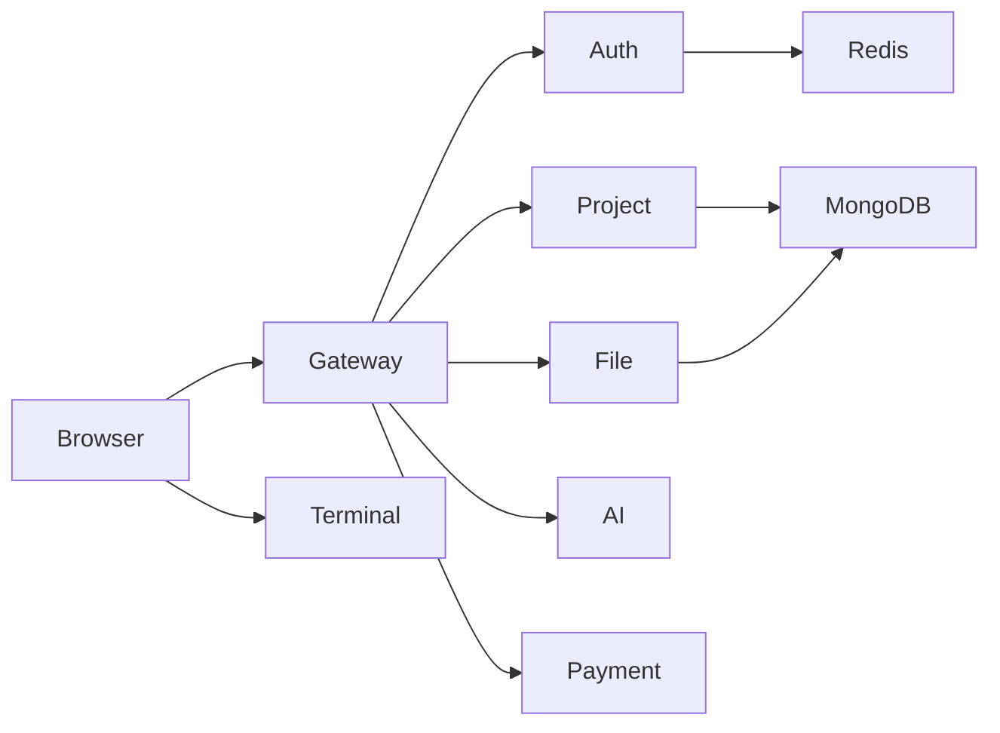

# Real-Time AI Code Editor

Browser-based IDE with Monaco, live preview, integrated terminal, and an AI agent that can read and edit project files.

## Tech stack

| Layer | Technologies |
|-------|----------------|
| **Frontend** | React, TypeScript, Vite, Tailwind CSS, Redux Toolkit, React Query, Monaco Editor, xterm.js, Socket.IO client |
| **Backend** | Node.js, Express, microservices behind an API gateway |
| **Data** | MongoDB (projects & virtual filesystem), Redis (sessions & cache) |
| **AI** | LangGraph agent, OpenRouter API, SSE streaming |
| **Terminal** | Socket.IO, `node-pty` (syncs project to a local workspace) |
| **Payments** | Razorpay (optional, `/plans`) |

## How it works

1. **Login** — User signs in via the auth service; the gateway stores a Redis-backed session cookie.
2. **Dashboard** — Project service lists and manages projects in MongoDB.
3. **Editor** — File service loads/saves files; Monaco edits content in the browser.
4. **Preview** — Frontend builds HTML/CSS/JS from the project tree for a live preview.
5. **Terminal** — Client connects directly to the terminal service; files sync from the file service into a workspace folder.
6. **AI chat** — Gateway proxies to the AI service; the agent streams responses and uses tools to create or update files (credits enforced).



**Gateway routes:** `/api/auth/*`, `/api/me`, `/api/project/*`, `/api/file/*`, `/api/ai/*`, `/api/payment/*`  
**Direct:** Terminal WebSocket (`VITE_TERMINAL_SERVICE_URL`, not through the gateway).

## Setup

**Requirements:** Node.js 18+ (20+ recommended), MongoDB, Docker (for Redis), OpenRouter API key for AI. Razorpay keys only if you use billing.

### 1. Redis

```bash
cd backend
docker compose up -d
```

### 2. Environment

Copy `.env.example` → `.env` in each service folder and in `frontend/`:

- `backend/gateway/`
- `backend/services/auth/`, `project/`, `file/`, `ai/`, `terminal/`, `payment/`
- `frontend/`

Use the same `MONGODB_URL` and service URLs as in the examples. Set `OPENROUTER_API_KEY` in `backend/services/ai/.env`.

### 3. Install

```bash
cd backend && npm install
cd gateway && npm install
cd ../services/auth && npm install
cd ../project && npm install
cd ../file && npm install
cd ../ai && npm install
cd ../terminal && npm install
cd ../payment && npm install
cd ../../frontend && npm install
```

### 4. Run

From `backend/`, start each service in its own terminal:

```bash
npm run dev:auth
npm run dev:project
npm run dev:file
npm run dev:ai
npm run dev:payment
npm run dev:terminal
npm run dev:gateway
```

Frontend:

```bash
cd frontend && npm run dev
```

Open **http://localhost:5173/login**, click **Let's start** (dev user **aditya**). Set `FRONTEND_URL` in gateway and terminal `.env` to match the frontend origin.

| Service | Default port |
|---------|----------------|
| Gateway | 8000 |
| Auth | 8011 (or 8001) |
| Project | 8002 |
| File | 8003 |
| AI | 8004 |
| Payment | 8005 |
| Terminal | 8006 |
| Frontend | 5173 |

Optional: `cd backend && npm run clear-cache` to flush Redis.

Do not commit `.env` files.

## Contributing

Thanks for helping improve this project.

1. **Fork** the repository and create a branch from `main` (e.g. `feat/short-description` or `fix/issue-name`).
2. **Make focused changes** — one logical change per PR when possible.
3. **Test locally** — Redis, MongoDB, gateway, the services you touched, and the frontend should run without errors.
4. **Follow existing style** — match naming and patterns in the codebase; run `npm run lint` in `frontend/` if you changed UI code.
5. **Keep secrets out** — never commit API keys, `.env`, or credentials.

## Pull requests

1. Push your branch to your fork and open a **Pull Request** against `main`.
2. Use a clear **title** and a short **description**: what changed and why.
3. Link any related **issue** if one exists.
4. Wait for review; address feedback with new commits on the same branch.
5. After merge, delete the branch if you no longer need it.

If something is unclear before you start, open an issue or ask in the PR draft — small, reviewable PRs are easier to merge.

## License

Copyright © 2026 **Aditya Pawar** — **Yantra AI**. All rights reserved.

See [LICENSE](LICENSE) for full terms.

